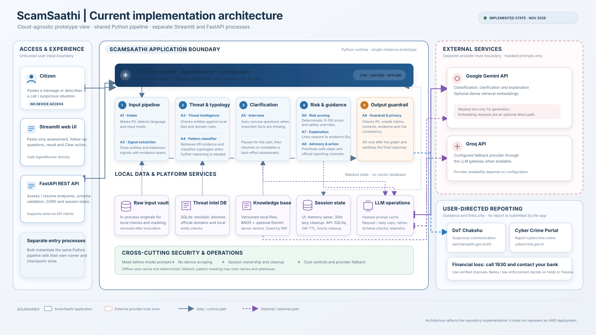

# ScamSaathi (स्कैम साथी)

**An Agentic AI Assistant for Mobile Scam Defense in India.**

> *Helping citizens identify mobile scams, understand social engineering manipulation, and take safe, official recovery steps before or after financial loss.*

---

| Attribute | Details |
| :--- | :--- |
| **Certification** | Hero Vired — Professional Certification in Agentic AI (Capstone Project) |
| **Author** | Thiagarajan Baskarasubramanian |
| **Architecture** | 9-Agent StateGraph with LangGraph & SQLite Checkpointer |
| **Primary LLMs** | Google Gemini (gemini-3.5-flash-lite / gemini-3.8-flash) |
| **Fallback LLMs** | Groq (llama-3.3-70b-versatile) with Circuit-Breaker Gateway |
| **Scope** | Mobile SMS, WhatsApp, and call transcripts in English & Hinglish |
| **Test Suite** | 268 Unit & Integration Tests (100% Passing) |
| **Evaluation** | 50-Case Comprehensive Benchmark (97.2% Scam Recall, 0% False Alarms on Banking) |

> ⚠️ **Important Safety Disclaimer**: ScamSaathi provides risk assessments and safety guidance, not legal advice or definitive investigative verdicts. Automated masking protects phone numbers, accounts, UPI IDs, emails, and contextual OTPs, but pattern matching cannot reliably redact personal names or street addresses. Always verify independently through official channels.

---

## 🌟 Key Capabilities

1. **Deterministic-First Agentic Defense**:
   - **Deterministic Rules & Threat Intel**: URL blocklists, TRAI designated service series (1600/1601), `.bank.in` / `.gov.in` domain legitimacy verification, and keyword signal extraction run deterministically before LLM invocation.
   - **Bounded LLM Reasoning**: LLMs classify Indian cyber fraud typologies (I4C SC-01 through SC-15) and explain social engineering tactics within bounded score delta limits.
   - **Deterministic Safety Floors**: Overrides enforce strict minimum risk scores and safety actions for critical indicators (e.g. `apk_attachment`, `urgent_recovery`, `child_safety`).

2. **Privacy by Design (DPDP Act Aligned)**:
   - **Zero Device Scraping**: Web paste-only architecture; no access to device SMS, contacts, or call logs.
   - **Local Pre-LLM Masking**: Sensitive identifiers (`<PHONE_1>`, `<BANK_ACC_1>`, `<UPI_ID_1>`, `<EMAIL_1>`, `<OTP_1>`) are replaced with masked placeholders before any data reaches an LLM.
   - **Ephemeral Raw Vault**: Raw text is held in an in-memory vault strictly for the duration of analysis and deleted immediately upon assessment completion.
   - **Client Session Isolation & TTL**: Thread IDs are strictly validated, checkpoint writes are purged on session clear, and CORS origins are locked down to trusted hosts.

3. **Human-in-the-Loop (HITL) Interactive Interview**:
   - Ambiguous messages trigger targeted, low-friction follow-up questions rather than guessing.
   - Structured multi-question answering allows users to confirm critical context (e.g., whether they initiated a call or sent money), updating the assessment deterministically upon resume.

4. **Actionable Citizen Recovery Guidance**:
   - Direct integration with verified Indian cyber defense channels:
     - **DoT Chakshu Facility**: Direct reporting for suspected fraud calls, SMS, and WhatsApp (`https://sancharsaathi.gov.in/sfc`).
     - **National Cyber Crime Reporting Portal**: Suspect registry for malicious phone numbers, UPI IDs, and phishing URLs (`https://cybercrime.gov.in`).
     - **1930 Financial Fraud Helpline**: Rapid golden-hour reporting guidance and bank coordination assistance when financial loss is reported (lien/freezing decisions remain the statutory remit of banks and law enforcement authorities).
     - **TRAI 1909**: DND and unsolicited commercial communications reporting.

---

## 🏗️ Multi-Agent Architecture

<p align="center">
  
</p>

The core pipeline is orchestrated via a LangGraph state graph consisting of 9 specialized agents plus a deterministic post-graph safety barrier:

```
                       [Citizen Input]
                              │
                              ▼
                       ┌─────────────┐
                       │   intake    │ ── Language detection (EN/Hinglish) & mode setup
                       └─────────────┘
                              │
                              ▼
                       ┌─────────────┐
                       │    intel    │ ── SQLite Threat Intel (URL blocklists, TRAI 1600, .bank.in)
                       └─────────────┘
                              │
                              ▼
                       ┌─────────────┐
                       │   extract   │ ── Entities & psychological urgency/coercion signals
                       └─────────────┘
                              │
                              ▼
                       ┌─────────────┐
                       │  prescreen  │ ── Fast-path check / deterministic rules baseline
                       └─────────────┘
                              │
               ┌──────────────┴──────────────┐
               │ (ambiguous / needs LLM)     │ (clear rules / fast path)
               ▼                             │
        ┌─────────────┐                      │
        │  classify   │ (SC-01 to SC-15)     │
        └─────────────┘                      │
               │                             │
        ┌──────┴──────┐                      │
 (ambiguous)   (conclusive)                  │
        ▼             │                      │
┌───────────────┐     │                      │
│ plan_questions│     │                      │
└───────────────┘     │                      │
        │             │                      │
        ▼             │                      │
┌───────────────┐     │                      │
│ await_answers │(HITL)                      │
└───────────────┘     │                      │
        │             │                      │
        └──────┬──────┘                      │
               ▼                             ▼
        ┌──────────────────────────────────────────┐
        │                  score                   │ ── Deterministic 0-100 & safety floors
        └──────────────────────────────────────────┘
                              │
                              ▼
        ┌──────────────────────────────────────────┐
        │              explain_advise              │ ── Evidence IDs (A8) & reporting advice (A7)
        └──────────────────────────────────────────┘
                              │
                              ▼
                       [StateGraph END]
                              │
                              ▼
        ┌──────────────────────────────────────────┐
        │           A9: GuardrailSanitizer         │ ── Post-graph PII, safety & advice gate
        └──────────────────────────────────────────┘
                              │
                              ▼
                     [Assessment Outcome]
```

---

## 📊 Benchmark Evaluation (Phase 7 & Hardened Rigor)

Evaluated on the 50-case benchmark dataset across both English and Hinglish inputs (`reports/benchmark_report.md`):

| Evaluation Metric | Target | Baseline B0 (Rules) | Full Agentic (Ours) | Rigorous Verification |
| :--- | :---: | :---: | :---: | :--- |
| **Scam Recall (Warned > LOW)** | >= 95.0% | 47.2% | **97.2%** | +50.0 pp gain; catches nuanced social engineering |
| **High-Risk Recall (HIGH/CRITICAL)** | >= 90.0% | 25.0% | **75.0%** | +50.0 pp gain (27/36 high-risk threats correctly escalated) |
| **False Alarm Rate (Legit > LOW)** | <= 10.0% | 0.0% | **9.1%** | 0% false alarms on authenticated `.bank.in` & TRAI headers |
| **Required Safety Behaviors** | 100.0% | 100.0% | **97.7%** | 43/44 behaviors met (1930 recovery, 1098 child safety) |
| **Typology Accuracy (Exact Top-1)** | >= 80.0% | N/A | **97.1%** | Exact primary typology classification |
| **Typology Top-3 Coverage** | >= 90.0% | N/A | **97.1%** | Primary typology included in top 3 predictions |
| **Evidence-ID Grounding Rate** | 100.0% | N/A | **100.0%** | Runtime citation consistency against active catalogue (S#, I#, K#, C#) |
| **Non-Devanagari Script Compliance** | 100.0% | 100.0% | **100.0%** | Zero Devanagari script leakage across evaluated response fields (script-level audit) |
| **Official Reporting Guidance** | N/A | N/A | **97.2%** | Direct Chakshu (88.9%), Cyber Crime Portal (94.4%), 1930 (100% urgent loss) |
| **Ambiguous Case Clarification** | 100.0% | 0.0% | **66.7%** | Interactive interview triggered on ambiguous text |

> **Audit Note on Safety Performance**: Baseline B0 achieved 100.0% on safety behaviors because its rule set fires template advice whenever a keyword triggers. Full Agentic achieved 97.7% (43/44 required behaviors), with one test case narrowly missing an advisory tag under LLM explanation formatting, keeping our remaining safety gap fully transparent.

---

## 🔒 Data Retention & Privacy by Interface (DPDP Principle 4 / 6)

ScamSaathi implements strict data minimization, purpose limitation, and storage limitation. Because the user experience differs between interactive web usage and API integration, retention is tailored specifically to each interface:

1. **Streamlit Web Application (`src/scamsaathi/ui/streamlit_app.py`)**:
   - **Ephemeral In-Memory Vault**: Raw unmasked text is stored in an in-memory vault solely during graph execution and popped immediately once analysis completes.
   - **Immediate Completed Outcome Purge**: When an assessment or resumed interview finishes with `status == "complete"`, LangGraph checkpoints and in-memory PII mappings are purged immediately (`runner.clear_session(thread_id, purge_checkpoint=True)`), and session thread tracking is reset.
   - **Paused Interview Inactivity TTL**: For ambiguous cases awaiting user answers (`status == "needs_followup"`), checkpoints and PII mappings remain in memory to support resumption. On the next user interaction after **30 minutes of inactivity**, the UI automatically purges the runner session, clears the stored outcome, and resets the input widget.
   - **Explicit User Clear**: Clicking the "Clear" button resets all session state, purges the in-memory runner session and checkpoint, and clears the input widget.

2. **FastAPI REST Backend (`src/scamsaathi/api/app.py`)**:
   - **Immediate Completed Outcome Purge**: For completed assessments (`status == "complete"`), SQLite `session_meta`, `checkpoints`, and `writes` records are purged atomically via `_purge_session_records` before returning the response. `session_token` in the response is set to `null`.
   - **Paused Session Retention & Security**: When follow-up clarification is needed (`status == "needs_followup"`), SQLite retains checkpoint records accompanied by a cryptographically random ownership token (`X-Session-Token`). Only callers presenting the matching token can resume or delete the session.
   - **24-Hour TTL & Background Purge**: Active/paused sessions expire after **24 hours**. An hourly background task and lazy assessment checks prune stale sessions; attempting to resume an expired session returns `410 Gone` and rolls back all records immediately.
   - **Right to Erasure Endpoint**: Callers can call `DELETE /session/{thread_id}` with their token to purge checkpoint records on demand.

---

## 🚀 Quick Start & Installation

### 1. Environment Setup

ScamSaathi requires Python 3.11+. We provide both a pinned `requirements.lock` (authoritative, verified) and a flexible `requirements.txt`:

```bash
# Clone the repository
git clone <repo-url>
cd scamsaathi

# Create and activate a virtual environment
python -m venv .venv
# On Windows:
.venv\Scripts\activate
# On Linux/macOS:
source .venv/bin/activate

# Install authoritative dependencies
pip install -r requirements.lock
# Or for standard installation:
pip install -e .
```

### 2. Configuration (`.env`)

Copy `.env.example` to `.env` and provide your API keys:

```bash
cp .env.example .env
```

Key configuration options (configured via `.env` or environment):
- `GEMINI_API_KEY`: Google Gemini API key (paid tier recommended).
- `GROQ_API_KEY`: Optional Groq API key for multi-provider fallback.
- `SCAMSAATHI_MODE`: Operating mode — `live` (calls model and caches), `cached` (reads cache only), or `offline` (deterministic fallback on cache miss).
- `GEMINI_MODEL_FAST`: Fast classification model (default: `gemini-3.5-flash-lite` from `config/llm.yaml`).
- `GEMINI_MODEL_REASONING`: Reasoning/explanation model (default: `gemini-3.8-flash` from `config/llm.yaml`).
- `SCAMSAATHI_MAX_LLM_CALLS_PER_REQUEST`: Per-request call budget cap (default: 6).
- `SCAMSAATHI_TRUSTED_PROXIES`: Comma-separated trusted upstream proxy IPs/hostnames (default: `127.0.0.1,::1,localhost,testclient`). The rate limiter only trusts `X-Forwarded-For` from direct peers in this list; reverse proxies must strip/overwrite incoming untrusted forwarding headers.

### 3. Running the Streamlit Web Application

```bash
streamlit run src/scamsaathi/ui/streamlit_app.py
```
Open your browser at `http://localhost:8501`.

### 4. Running the FastAPI REST Service

```bash
uvicorn scamsaathi.api.app:app --host 127.0.0.1 --port 8000 --reload
```
Interactive API docs available at `http://localhost:8000/docs`.
- Features cryptographic session token ownership verification and automated 24-hour checkpoint TTL cleanup.
- Includes sliding-window rate limiting (60 req/min) with bounded tracking memory that preserves active clients' counters (no rate-limit bypass under high-cardinality bursts; horizontally scaled deployments should configure a shared distributed limiter such as Redis).

### 5. Running the Air-Gapped Offline Demo

Demonstrates multi-agent analysis on 15 canonical Indian scam scenarios without requiring live internet or API keys:

```bash
python scripts/run_agentic.py
```

### 6. Running the Benchmark Harness

```bash
python scripts/run_benchmarks.py
```

---

## 🧪 Testing & Verification

Run the full pytest suite (268 unit and integration tests):

```bash
pytest -v
```

All tests run completely offline and verify:
- Deterministic signal extractors and blocklist queries
- PII masking and raw vault clearing
- State graph routing and interrupt-resume cycles
- LLM Gateway caching, retries, and fallback circuit-breakers
- FastAPI endpoints, session ownership tokens, 24h TTL cleanup, CORS restrictions, and session deletion
- Advice engine contact allowlists and URL validation

---

## 📁 Repository Structure

```
scamsaathi/
├── config/                 # Gateway model tiers, fallbacks & costs (llm.yaml)
├── data/
│   ├── advice/             # Canonical advice templates (advice.yaml)
│   ├── contacts/           # Verified official Indian reporting channels (contacts.yaml)
│   ├── demo/               # Air-gapped offline gold demo cache
│   ├── evaluation/         # 50-case benchmark evaluation dataset (eval_dataset.jsonl)
│   ├── intel/              # Threat intel blocklists and designated numbers
│   └── kb/                 # Indian cyber fraud typologies (SC-01 to SC-15) & embeddings
├── docs/                   # Full project documentation & architectural decisions
├── reports/                # Benchmark evaluation reports & execution metadata
├── scripts/
│   ├── build_kb.py         # Knowledge base builder
│   ├── run_agentic.py      # Air-gapped offline interactive demo
│   └── run_benchmarks.py   # Comprehensive benchmarking harness
├── src/scamsaathi/
│   ├── agents/             # 9 specialized LangGraph agents
│   ├── api/                # FastAPI application, security & Pydantic schemas
│   ├── evaluation/         # Benchmark evaluation metrics & ground truth labels
│   ├── graph/              # LangGraph state graph wiring and node transitions
│   ├── kb/                 # Curated knowledge base store and advice builder
│   ├── llm/                # LLM gateway, disk cache, budget & model providers
│   ├── pipeline/           # AgentRunner & Baseline B0 pipeline
│   ├── prompts/            # Agent prompt templates
│   ├── tools/              # PII masker, threat intel DB, rule signals & risk scorer
│   ├── ui/                 # Streamlit web user interface
│   ├── config.py           # Pydantic Settings & environment loader
│   ├── logging_setup.py    # Structured logging configuration
│   └── schemas.py          # Core Pydantic domain schemas
├── tests/                  # 268 unit and integration tests
├── pyproject.toml          # Project metadata & configuration
├── requirements.txt        # Pinned direct dependencies
├── requirements-dev.txt    # Development and test dependencies
└── requirements.lock       # Authoritative full environment lock
```

---

## 📜 License & Disclaimers

Developed as a Capstone Project for the Hero Vired Professional Certification in Agentic AI.
All rights reserved © 2026 Thiagarajan Baskarasubramanian.
