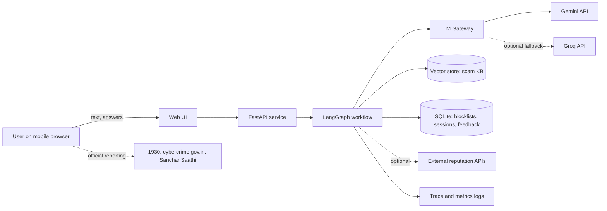
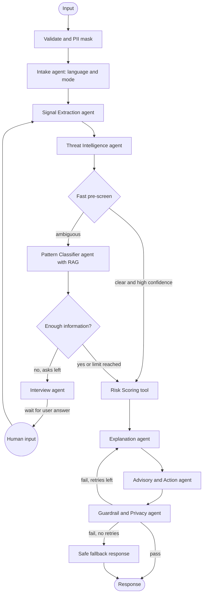
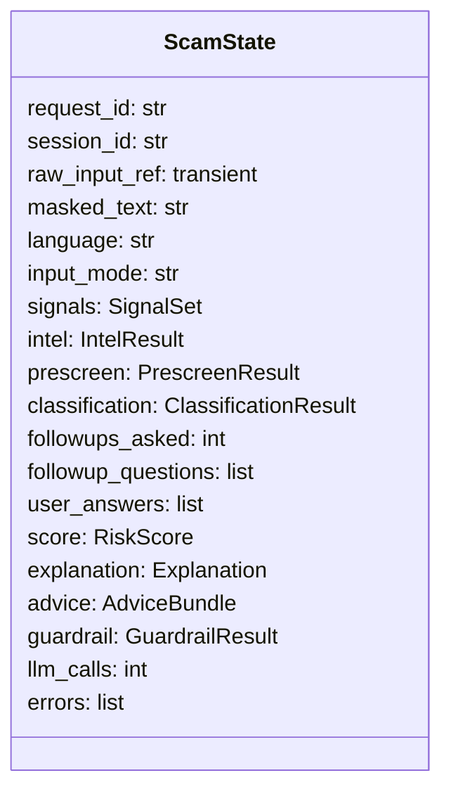
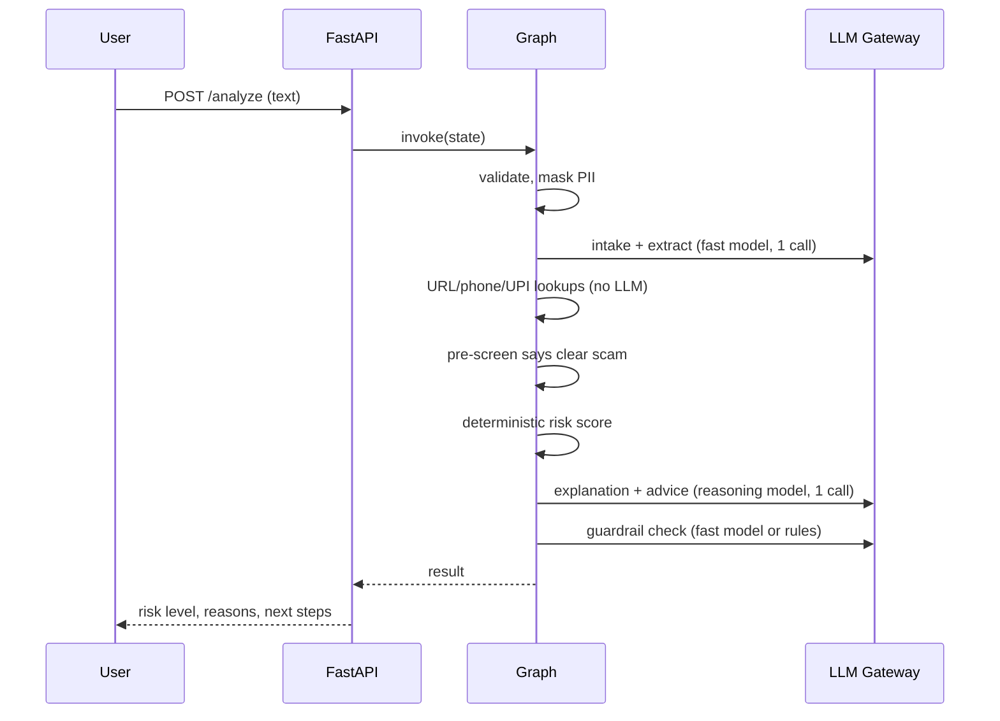
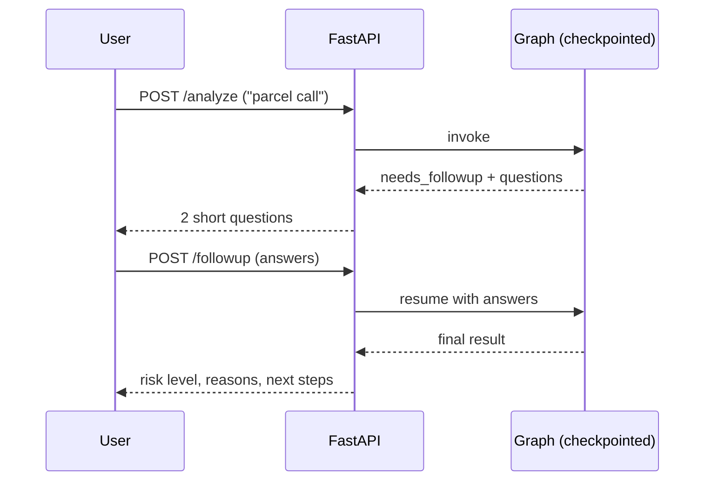
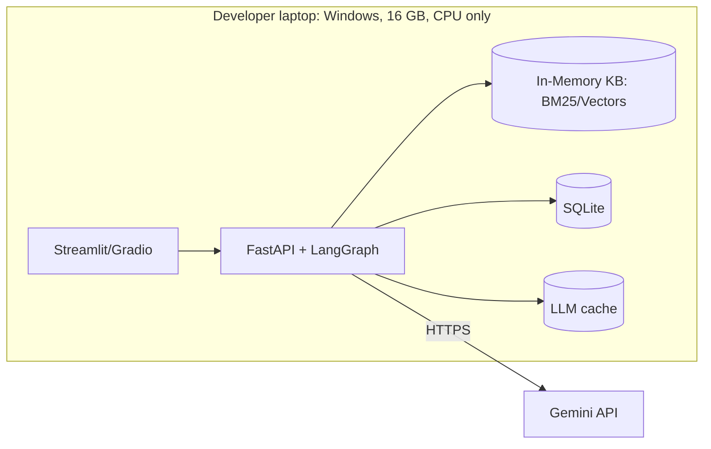

# 04. Architecture

| Field | Value |
|---|---|
| Version | 1.0 (Approved) |
| Date | 2026-11-11 |
| Related ADRs | ADR-001, ADR-002, ADR-003, ADR-004, ADR-005, ADR-006 |

## 1. Architectural principles

1. **Deterministic first, LLM where it adds value.** Extraction, lookups, and scoring are code. The LLM handles ambiguity, language, and explanation.
2. **Typed state.** All nodes read and write a single validated state object.
3. **Privacy by design.** PII is masked before any LLM call or log write.
4. **Graceful degradation.** Every LLM node has a deterministic or cached fallback.
5. **Explainability.** Every output field is traceable to evidence.
6. **Provider independence.** Models and providers are configuration, not code.
7. **Cost awareness.** Per-request call caps, caching, and tiered models.

## 2. System context

ScamSaathi never contacts the official reporting channels itself. It only tells the user how to reach them.

## 3. Logical components

| Component | Responsibility | Tech |
|---|---|---|
| Web UI | Input, follow-up dialog, result display | Streamlit or Gradio (ADR-005) |
| API layer | Validation, session handling, routing to graph | FastAPI, Pydantic |
| Orchestrator graph | Workflow, routing, state, checkpoints | LangGraph |
| Agents/nodes | See document 05 | Python, LLM calls |
| Tools | Deterministic functions and retrievers, see document 06 | Python |
| LLM Gateway | Provider abstraction, retries, cache, budget, masking enforcement | Python (google-genai or LangChain adapters) |
| Knowledge base | Scam typologies, advisories, official contacts | In-memory Hybrid BM25 + Gemini Embeddings (ADR-004) |
| Relational store | Blocklists, allowlists, sessions, feedback | SQLite |
| Telemetry | Structured logs, traces, cost | Python logging, optional LangSmith |
| Evaluation harness | Offline batch runs and metrics | pytest + scripts |

## 4. Agent topology

The Orchestrator is the LangGraph graph itself (routing functions and the state machine). It is not a separate LLM call. This keeps cost low and routing deterministic. See ADR-006.

## 5. Shared state (conceptual schema)

Rules:
- `raw_input_ref` is held in memory only for the current request. It is not checkpointed to disk. Only `masked_text` is checkpointed.
- Each node returns a partial state update. Reducers merge lists such as `errors`.
- Full field definitions are in document 06 (schemas).

## 6. Key sequences

### 6.1 Happy path, clear scam

### 6.2 Interview path

### 6.3 Provider failure

LLM Gateway tries primary provider, retries with backoff on 429/5xx, then the configured fallback, then the cache, then returns a deterministic-only result flagged `degraded=true`.

## 7. LLM Gateway design

| Concern | Design |
|---|---|
| Provider abstraction | Interface `generate(task, messages, schema, tier)` returning validated Pydantic output |
| Tiers | `fast` and `reasoning`, each mapped to provider/model by configuration |
| Structured output | JSON schema enforced and validated; one repair retry on invalid JSON |
| Cache | Disk cache keyed by SHA-256 of (tier, model, prompt template version, masked prompt) |
| Budget | Per-request call cap and daily call/cost budget; refuse with degraded result when exceeded |
| Retry | Exponential backoff with jitter, max 3 |
| Masking | Gateway rejects any prompt containing unmasked PII patterns (defence in depth) |
| Modes | `live`, `cached` (read cache, fail if miss), `offline` (cache plus deterministic only) |
| Telemetry | Tokens, latency, model, cache hit, estimated cost per call |

## 8. Model tiering (see ADR-001)

| Tier | Used for | Model |
|---|---|---|
| `fast` | Intake, signal extraction, guardrail checks | Low-latency Gemini model (name TBD) |
| `reasoning` | Pattern classification on ambiguous input, explanation, advice wording | Stronger Gemini model (name TBD) |
| `embedding` | KB retrieval | Local multilingual embedding model on CPU, or Gemini embedding (decision in ADR-004) |

Exact model IDs are set in configuration after confirmation in AI Studio (open question Q-3).

## 9. Data stores

| Store | Content | Persistence |
|---|---|---|
| In-memory KB (BM25 + Vectors) | Typology chunks, advisories, official contact entries | Built from `data/kb/`, rebuildable (ADR-004) |
| SQLite `intel.db` | `blocklist`, `allowlist`, `official_domains` | Seeded from `data/intel/` |
| SQLite `sessions.db` | Checkpoints with masked text only, TTL 24 h | Local file, git-ignored |
| SQLite `feedback.db` | Optional feedback records (no raw text) | Local file, git-ignored |
| LLM cache | Hashed prompt to response | Local folder, git-ignored |

## 10. Deployment view

Optional: deploy to a free-tier host for a shareable demo link. Secrets via environment variables. Decision deferred (document 14).

## 11. Technology stack

| Layer | Choice | Notes |
|---|---|---|
| Language | Python 3.11+ | Pin exact versions in `requirements.lock` at build time |
| Orchestration | LangGraph | ADR-002 |
| Schemas | Pydantic v2 | Typed state and tool I/O |
| LLM SDK | Google Gen AI SDK or LangChain Google adapter | Decide during spike, record in ADR-001 addendum |
| API | FastAPI + Uvicorn | |
| UI | Streamlit or Gradio | ADR-005 |
| Vector store / KB | In-memory Hybrid BM25 + Gemini Embeddings (no vector DB) | ADR-004 |
| DB | SQLite | |
| Testing | pytest, pytest-asyncio, hypothesis (optional) | |
| Lint/format | ruff, mypy | |
| Observability | structlog/JSON logs, optional LangSmith | Check LangSmith free quota and data policy before enabling |

Library versions are not pinned in this document. They will be verified and pinned during implementation (log entry in document 13).

## 12. Cross-cutting concerns

- **Error handling:** Each node catches provider errors, appends to `errors`, and the router decides whether to continue in degraded mode.
- **Configuration:** `pydantic-settings` reading environment and `config/*.yaml` (thresholds, weights, model tiers).
- **Idempotency:** Request ID per call; same masked input in cached mode returns the same output.
- **Time limits:** Per-node timeout (default 20 s) and overall request timeout (default 60 s).

## 13. Quality attribute mapping

| Attribute | Tactics |
|---|---|
| Performance | Fast path skips the reasoning model; parallel intel lookups; cache |
| Cost | Tiering, call cap, cache, budget guard |
| Reliability | Retries, fallback chain, offline mode |
| Security/Privacy | PII masking, no raw persistence, secrets in env, injection defences |
| Explainability | Evidence list, score breakdown |
| Testability | Pure functions for tools and scorer; node-level tests with a fake LLM |
