# 10. Project Plan

| Field | Value |
|---|---|
| Version | 1.0 (Approved) |
| Date | 2026-11-11 |
| Deadline | TBD (Q-2). Dates below are relative (Week 1, 2, ...). Convert to calendar dates once the deadline is known |

## 1. Approach

Spec-driven, iterative. Each phase ends with a demonstrable increment, updated documents, and a log entry. Kiro specs (`.kiro/specs/<feature>/requirements.md, design.md, tasks.md`) are derived from documents 03 to 07 to keep code and docs aligned.

## 2. Phases and milestones

| Phase | Name | Key outputs | Exit criteria | Est. effort |
|---|---|---|---|---|
| P0 | Documentation and decisions | Docs 01 to 15 skeleton, ADRs | Author review complete, open questions Q-1 to Q-4 resolved | 2 to 3 days |
| P1 | Foundations | Repo scaffold, config, LLM gateway with cache/offline, PII masker, logging, CI checks | Gateway tests pass, one live Gemini call succeeds, secret scan clean | 3 to 4 days |
| P2 | Deterministic core | Entity extractor, URL analyzer, reputation lookup, risk scorer, intel DB | Unit tests pass | 3 to 4 days |
| P3 | Knowledge base and RAG | Typology files, embeddings, retriever | Retrieval tests pass on dev set | 3 days |
| P4 | Agent graph | Intake, extraction, pre-screen, classifier, explanation/advice, graph wiring | End-to-end run on demo scenarios | 4 to 5 days |
| P5 | Interview and sessions | Interview agent, checkpointing, resume | IT-INT tests pass | 2 to 3 days |
| P6 | Guardrails and API/UI | Guardrail agent, FastAPI, UI, report generator | Security tests pass, UI usable at 360 px | 3 to 4 days |
| P7 | Evaluation | Dataset, harness, baselines, report | Test split run, error analysis | 3 to 4 days |
| P8 | Hardening and demo | Cache for demo, rehearsals, polish, deployment notes | Demo rehearsed in live, cached, offline | 2 days |
| P9 | Final review and release | Documentation finalized, release verification | Release ready | 2 to 3 days |

Total estimate: about 5 to 6 weeks part-time. Estimates are planning guesses by the author, to be revised after P1 using actual velocity.

```mermaid
gantt
    title ScamSaathi plan (relative weeks)
    dateFormat  X
    axisFormat  W%s
    section Docs
    P0 Documentation            :0, 1
    section Build
    P1 Foundations              :1, 2
    P2 Deterministic core       :2, 3
    P3 KB and RAG               :3, 4
    P4 Agent graph              :4, 5
    P5 Interview and sessions   :5, 6
    P6 Guardrails API UI        :6, 7
    section Validate
    P7 Evaluation               :7, 8
    P8 Hardening and demo       :8, 9
    P9 Final review & release   :9, 10
```

(The Gantt shows a conservative sequential view of 10 relative units. Overlaps are expected, which is how the 5 to 6 week estimate arises.)

## 3. Work breakdown (high level)

1. Governance and docs: charter, requirements, ADRs, logs.
2. Platform: config, gateway, telemetry, secrets handling.
3. Deterministic tools: masker, extractor, URL analyzer, reputation, scorer.
4. Knowledge: typologies, advisories, contacts, advice templates.
5. Agents: nodes, prompts, graph, routers.
6. Interface: API, UI, report generator.
7. Quality: tests, dataset, evaluation, security checks.
8. Delivery: demo, release verification, review.

Detailed tasks will be generated in `.kiro/specs/*/tasks.md` after approval of this documentation.

## 4. RACI

Single-developer project; the AI assistant acts as a pair-programmer.

| Activity | Author (Thiagarajan Baskarasubramanian) | Kiro (AI assistant) | Mentor / reviewer |
|---|---|---|---|
| Scope and decisions | A / R | C | C |
| Documentation drafting | A | R | I |
| Implementation | A | R | I |
| Code review and acceptance | A / R | C | I |
| Dataset review | A / R | C | I |
| Evaluation sign-off | A / R | C | C |
| Final submission | A / R | C | I |

R = responsible, A = accountable, C = consulted, I = informed. The author reviews and understands all code before submission (important for viva or demo questions).

## 5. Budget

| Item | Plan |
|---|---|
| Available funds | About Rs.500 prepaid plus eligible promotional credits (displayed as about Rs.6.67K; usable amount and coverage to be verified, Q-4) |
| Controls | Budget alert in Google console, daily call budget in config, cache, 10-case pilot before any full run |
| Evaluation estimate | To be computed in P7 from measured tokens per call |
| Review points | End of P1 (measure cost per request), end of P7 (actuals vs plan) |

Rule: if the projected spend for a run exceeds 25% of remaining funds, reduce the run size or use the cache.

## 6. Communication and cadence

- Start of each work session: read the implementation log (document 13) and open risks.
- End of each session: add a log entry (what was done, decisions, issues, next step).
- End of each phase: update CHANGELOG and requirement traceability status.

## 7. Definition of Done (per task)

1. Code written with type hints and docstrings.
2. Tests added and passing.
3. Lint and type checks pass.
4. Relevant doc section updated.
5. Log entry added.
6. No secrets or real data committed.
7. At each phase start: versions re-checked per ADR-008 (`pip list --outdated`, vulnerability check, Gemini deprecations page) and findings logged.

## 8. Dependencies

| Dependency | Needed by | Owner | Status |
|---|---|---|---|
| Gemini API key and model IDs | P1 | Author | Key purchased; model IDs to confirm (Q-3) |
| Python 3.11+ environment | P1 | Author | To verify |
| Framework confirmation by course | P0 | Author | Open (Q-1) |
| Deadline and demo format | P0 | Author | Open (Q-2) |
| Verified official contacts and advisories | P3 | Author with Kiro research | Open |
| Embedding model decision and download | P3 | Kiro | Open (ADR-004) |

## 9. Assumption of effort

Estimates assume about 2 to 3 hours per weekday. Adjust once the real availability is known.
