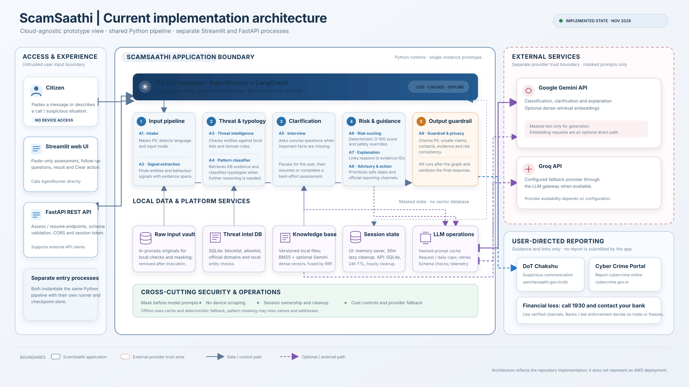

# 16. Current Architecture View

**Implementation view**  
This diagram reflects the current code paths. The Streamlit UI and FastAPI API are separate entry points into the same Python pipeline; the Streamlit UI calls `AgentRunner` directly and does not call the FastAPI service.

The SVG is a scalable vector asset suitable for the final report or slide deck. Its component labels, boundaries, arrows, and trust zones remain editable in vector-capable tools.

## How to read the diagram

- **Two interfaces, one code path:** both interfaces use `AgentRunner` and the LangGraph workflow, but they run in their own process and use different checkpoint stores.
- **Agent roster:** A0 orchestrates the workflow. A1 handles intake and masking; A2 extracts signals; A3 checks local threat intelligence; A4 retrieves typologies and classifies; A5 asks follow-up questions; A6 scores risk; A7 explains the evidence; A8 provides prioritized advice; A9 checks and sanitizes the output. A9 runs after graph completion. A7 and A8 have distinct roles but share one model call. A10 feedback is a stretch item and is not shown as implemented.
- **Conditional cost and reasoning path:** deterministic prescreening and retrieval can skip model classification for clear cases. The LLM gateway applies cache and budget controls to model calls. Dense KB embeddings are optional and may call Gemini directly.
- **Privacy boundary:** the raw-input vault supports local lookups and masking. Graph checkpoints and prompts use masked content. Names and street addresses may escape pattern-based masking; users are warned not to include them.
- **Session retention differs by interface:** Streamlit uses in-memory state and checks its 30-minute inactivity timeout on the next rerun. FastAPI uses SQLite checkpoints and prunes expired sessions hourly, with a 24-hour TTL.
- **Safe-use boundary:** results provide advisory risk assessments and reporting guidance. The app does not submit reports, block communications, or freeze funds.

## Implementation references

- Workflow and routing: `src/scamsaathi/graph/builder.py`, `src/scamsaathi/graph/routers.py`
- Runtime and masking: `src/scamsaathi/pipeline/agentic.py`, `src/scamsaathi/agents/intake.py`, `src/scamsaathi/agents/context.py`
- API and Streamlit entry points: `src/scamsaathi/api/app.py`, `src/scamsaathi/ui/streamlit_app.py`
- Retrieval and model gateway: `src/scamsaathi/kb/retrieval.py`, `src/scamsaathi/llm/gateway.py`
